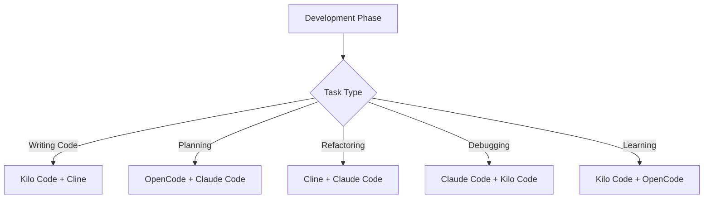

# AI Development Tools

Complete guide to AI coding assistants integrated with XaresAICoder.

## Table of Contents

- [Overview](#overview)  
- [VS Code Extensions](#vs-code-extensions)
- [Command Line Tools](#command-line-tools)
- [Setup Guide](#setup-guide)
- [Updating the Tools](#updating-the-tools)
- [Tool Comparison](#tool-comparison)
- [Best Practices](#best-practices)
- [Troubleshooting](#troubleshooting)

## Overview

XaresAICoder provides a curated selection of AI coding assistants that work seamlessly together in your development workspace. Each tool serves different use cases and can be combined for a comprehensive AI-enhanced development experience.

### Tool Categories

**🎯 VS Code Extensions** - Integrated directly into the editor (pre-installed)
- **Cline** - Autonomous agent for multi-file edits and terminal commands
- **Kilo Code** - Open source agent with chat, autocomplete and modes for planning, coding and debugging
- **Claude Code for VS Code** - Claude Code panel next to the editor

**⌨️ Command Line Tools** - Terminal-based AI assistants (pre-installed)
- **OpenCode** - Multi-model AI with project analysis
- **Claude Code** - Anthropic's agentic coding tool
- **OpenAI Codex CLI** - OpenAI's terminal-based coding assistant
- **GitHub Copilot CLI** - GitHub Copilot in the terminal
- **Crush** - Multi-model AI with session management
- **Pi** - Minimal multi-provider coding harness

## VS Code Extensions

All three extensions are pre-installed in the workspace image (listed in `code-server/extensions.txt`). Automatic extension updates are disabled (`"extensions.autoUpdate": false`), so all participants of a workshop keep the same versions; update extensions manually in the Extensions view.

### Cline - Autonomous Coding Agent

**Best for**: Complex refactoring, multi-file operations, automated development tasks

#### Features
- ✅ **Direct File Editing** - AI makes changes directly to your files
- ✅ **Multi-File Operations** - Coordinate changes across multiple files
- ✅ **Terminal Integration** - Execute commands and see results
- ✅ **Step Approval** - You approve each step before it is carried out
- ✅ **Project Understanding** - Analyzes entire codebase
- ✅ **Task Automation** - Complete development tasks autonomously
- ✅ **Bring Your Own Key** - Anthropic, OpenAI, OpenRouter, local models and more, or a Cline account

#### Installation
Pre-installed (extension ID `saoudrizwan.claude-dev`).

#### Setup
1. Open Command Palette (`Ctrl+Shift+P`)
2. Search for "Cline: Open"
3. Choose a provider and enter your API key (Anthropic, OpenAI, OpenRouter, local models, ...), or sign in with a Cline account

Cline stores its data in `~/.cline`.

#### Usage Examples
- **Refactoring**: "Refactor this component to use React hooks"
- **Feature Development**: "Add user authentication to this Express app"
- **Bug Fixing**: "Fix the memory leak in this Python script"
- **Testing**: "Write comprehensive tests for this module"

### Kilo Code - Open Source Coding Agent

**Best for**: Inline autocomplete, chat about your code, switching between planning, coding and debugging

#### Features
- ✅ **Open Source** - MIT licensed
- ✅ **Chat** - Ask questions about your code and hand over tasks
- ✅ **Autocomplete** - AI suggestions as you type
- ✅ **Modes** - Separate modes for planning, coding and debugging
- ✅ **Many Providers** - Kilo account (gateway to many models) or your own API keys for 30+ providers

#### Installation
Pre-installed (extension ID `kilocode.kilo-code`).

#### Setup
1. Open the Kilo Code panel in VS Code
2. Sign in with a Kilo account, or enter your own API key for one of the supported providers

Kilo Code stores its data in `~/.local/share/kilo`.

Kilo runs shell commands normally in the workspaces. Do not switch on its optional sandbox for new sessions: it uses `bwrap`, which needs unprivileged user namespaces, and Docker's default seccomp profile of the workspaces blocks them (same as Codex's own sandbox).

#### Usage Examples
- **Planning**: "Plan how to add user authentication to this app"
- **Coding**: "Implement the plan in the auth module"
- **Debugging**: "Why does the login test fail?"

### Claude Code for VS Code - Claude Code in the Editor

**Best for**: Working with Claude Code next to your code and reviewing its changes in the editor

#### Features
- ✅ **Chat Panel** - Claude Code next to the editor
- ✅ **Inline Diffs** - Review proposed changes directly in your files
- ✅ **Plan Review** - Review Claude's plan before it starts
- ✅ **Shared Login** - Uses the same login as the `claude` CLI (`~/.claude`)

#### Installation
Pre-installed (extension ID `anthropic.claude-code`).

#### Setup
Log in once with the `claude` CLI (see Claude Code below); the extension uses the same login.

## Command Line Tools

All CLI tools are installed with npm into `/opt/ai-tools`, owned by the workspace user `coder`; `/opt/ai-tools/bin` is appended to `PATH`. Updates need no sudo (see [Updating the Tools](#updating-the-tools)).

### OpenCode - Multi-Model AI Assistant

**Best for**: Project analysis, collaborative development, multi-model support

#### Features
- ✅ **Open Source** - Repository at https://github.com/anomalyco/opencode
- ✅ **Multi-Model Support** - 75+ providers, switch between different AI models
- ✅ **Flexible Sign-In** - GitHub Copilot or ChatGPT account, or provider API keys
- ✅ **Project Analysis** - Deep understanding of project structure
- ✅ **Collaborative Sessions** - Share sessions with team members
- ✅ **Context Management** - Maintains conversation context
- ✅ **File Operations** - Read, write, and analyze files

#### Setup
```bash
# OpenCode v2 is pre-installed via npm (@opencode/cli)

# Authenticate (provider API key, or GitHub Copilot / ChatGPT account)
opencode auth login

# Initialize project analysis
opencode
# Then type: /init
```

OpenCode stores its data in `~/.local/share/opencode`. Automatic updates are disabled (`OPENCODE_DISABLE_AUTOUPDATE=1`). Documentation: https://opencode.ai/docs

#### Key Commands
```bash
# Start interactive session
opencode

# Initialize project analysis
/init

# Share session for collaboration
/share

# Switch AI models
/model gpt-4
/model claude-3-sonnet

# Get help
/help
```

### Claude Code - Anthropic's Agentic Tool

**Best for**: Deep codebase understanding, multi-file editing, advanced workflows

#### Features
- ✅ **Codebase Intelligence** - Understands entire project structure
- ✅ **Multi-File Editing** - Coordinate changes across many files
- ✅ **Git Workflow Integration** - Automated git operations
- ✅ **Advanced Reasoning** - Complex problem solving and planning
- ✅ **Context Retention** - Maintains understanding across sessions

#### Setup
```bash
# Option 1: Claude Pro/Max subscription
claude
# Follow the login prompt: open the URL shown in your browser,
# sign in, and paste the code back into the terminal

# Option 2: API key
export ANTHROPIC_API_KEY=your_key_here
```

Claude Code is pre-installed via npm (`@anthropic-ai/claude-code`) and stores its login and data in `~/.claude`; the Claude Code for VS Code extension uses the same login. Automatic updates are disabled (`DISABLE_AUTOUPDATER=1`); `claude update` still works manually.

#### Usage
```bash
# Start agentic coding session
claude

# Example tasks:
# "Implement user authentication system"
# "Refactor this codebase to use microservices"
# "Add comprehensive testing to all modules"
# "Optimize the database schema and queries"
```

### OpenAI Codex CLI - Terminal-Based Coding Assistant

**Best for**: Terminal-based development, ChatGPT integration, local AI assistance

#### Features
- ✅ **Local AI Assistant** - Runs directly in your terminal
- ✅ **ChatGPT Integration** - Works with Plus/Pro/Team/Enterprise plans
- ✅ **Model Context Protocol** - Advanced context management (MCP)
- ✅ **Interactive Sessions** - Natural conversation about code
- ✅ **Non-Interactive Mode** - Scriptable AI operations
- ✅ **Configurable Models** - Choose from multiple OpenAI models

#### Setup
```bash
# Option 1: Sign in with your ChatGPT account
codex login --device-auth

# Option 2: Use an OpenAI API key
export OPENAI_API_KEY=your_key_here
printenv OPENAI_API_KEY | codex login --with-api-key
```

Codex CLI is pre-installed via npm (`@openai/codex`) and stores its login and data in `~/.codex`. Copying `~/.codex/auth.json` from a machine where you are already logged in still works, but is no longer needed.

#### Usage
```bash
# Start interactive session
codex

# Direct prompt execution
codex "How do I implement OAuth in Python?"

# Non-interactive mode
codex exec "Write a REST API endpoint for user registration"

# With model selection
codex -m o3 "Optimize this Python function for performance"

# Apply generated diffs
codex apply

# Check authentication status
codex login --status
```

#### Configuration
```bash
# Create config file at ~/.codex/config.toml
[model]
provider = "openai"
name = "gpt-4"

[sandbox]
mode = "workspace-write"

[approval]
policy = "untrusted"
```

### GitHub Copilot CLI - GitHub Copilot in the Terminal

**Best for**: Using your GitHub Copilot plan in the terminal, including the Free and Student plans

#### Features
- ✅ **Included in Every Copilot Plan** - Including GitHub Copilot Free and Student
- ✅ **Interactive Login** - `/login` inside the CLI
- ✅ **Headless Login** - Fine-grained personal access token via `GH_TOKEN`

#### Setup
```bash
# Option 1: Interactive login
copilot
# Then type: /login

# Option 2: Headless login with a fine-grained personal access token
# that has the "Copilot Requests" permission
export GH_TOKEN=your_fine_grained_token
copilot
```

GitHub Copilot CLI is pre-installed via npm (`@github/copilot`) and stores its data in `~/.copilot`. Automatic updates are disabled (`COPILOT_AUTO_UPDATE=false`). Documentation: https://github.com/github/copilot-cli

### Crush - Multi-Model AI Coding Agent

**Best for**: Multi-model flexibility, session-based workflows, cross-platform terminal coding

#### Features
- ✅ **Multi-Model Support** - Switch between OpenAI, Anthropic, Google, Groq, OpenRouter
- ✅ **Session Management** - Maintain multiple work contexts per project
- ✅ **In-Session Switching** - Change models without losing conversation context
- ✅ **LSP Integration** - Enhanced code understanding via Language Server Protocol
- ✅ **MCP Extensibility** - Model Context Protocol support for custom tools
- ✅ **Cross-Platform** - Works on all major operating systems
- ✅ **Permission Control** - Approve or whitelist tool executions
- ✅ **Configuration Files** - Project-specific and global settings support

#### Setup

##### Manual Setup
```bash
# Crush is pre-installed via npm (@charmland/crush)

# Set your preferred API key (choose one or more)
export ANTHROPIC_API_KEY=your_key_here
export OPENAI_API_KEY=your_key_here
export GEMINI_API_KEY=your_key_here
export GROQ_API_KEY=your_key_here
export OPENROUTER_API_KEY=your_key_here
```

#### Usage
```bash
# Start interactive session
crush

# Start or resume named session
crush --session my-feature

# List all sessions
crush --list-sessions

# Switch models mid-session (type in Crush)
/model claude-3-5-sonnet
/model gpt-4
/model gemini-pro

# Use specific model from start
crush --model anthropic/claude-3-5-sonnet-20241022
```

#### Configuration

Create `.crush.json` in your project root or `~/.config/crush/crush.json` globally:

```json
{
  "model": "anthropic/claude-3-5-sonnet-20241022",
  "temperature": 0.7,
  "tools": {
    "allowed": ["read_file", "write_file", "run_command"]
  },
  "lsp": {
    "enabled": true
  },
  "sessions": {
    "auto_save": true,
    "max_history": 100
  }
}
```

#### Example Session
```bash
$ crush
🎀 Crush v1.0.0
Using model: claude-3-5-sonnet

> Analyze this codebase and suggest improvements

[Crush analyzes files using LSP and provides suggestions]

> /model gpt-4
Switched to model: gpt-4

> Implement the suggested changes
[Crush makes changes with GPT-4 context preserved]

> /save improvement-session
Session saved: improvement-session
```

#### Key Features Explained

**Session Management**:
- Maintain separate contexts for different features/tasks
- Resume work exactly where you left off
- Share sessions with team members

**Model Switching**:
- Switch between models without losing context
- Use different models for different subtasks
- Cost optimization by using cheaper models when appropriate

**LSP Integration**:
- Understands your code structure via Language Server Protocol
- Better code completion and suggestions
- Intelligent refactoring capabilities

**Permission System**:
```bash
# Approve each tool execution (default)
crush

# Auto-approve all (use with caution)
crush --yolo

# Configure approved tools in .crush.json
```

### Pi - Minimal Multi-Provider Coding Harness

**Best for**: Provider-agnostic terminal coding, fast iteration, scripting agent workflows

#### Features
- ✅ **15+ Providers** - Anthropic, OpenAI, Google, Azure, Bedrock, Mistral, Groq, Cerebras, xAI, HuggingFace, and more
- ✅ **OAuth & API Keys** - Choose authentication per provider
- ✅ **In-Session Model Switching** - `/model` or `Ctrl+L` to swap models without losing context
- ✅ **Multiple Modes** - Interactive, print (`-p`), JSON, RPC, and SDK
- ✅ **Minimal Surface Area** - "Adapts to your workflow, not the other way around"
- ✅ **Fast Execution** - Lightweight harness with low per-task overhead

#### Setup

##### Manual Setup
```bash
# Pi is pre-installed via npm (@earendil-works/pi-coding-agent)

# Set your preferred API key (one or more)
export ANTHROPIC_API_KEY=your_key_here
export OPENAI_API_KEY=your_key_here
export GEMINI_API_KEY=your_key_here
export GROQ_API_KEY=your_key_here

# Or use OAuth (provider-dependent): start pi, then type
/login
```

Documentation: https://pi.dev

#### Usage
```bash
# Start interactive session
pi

# One-shot print mode (good for scripts)
pi -p "Explain what main.py does"

# JSON output mode (for piping into tools)
pi --json -p "List the public functions in src/api.js"

# Switch models mid-session
/model claude-3-5-sonnet
/model gpt-4
```

#### Example Session
```bash
$ pi
Pi v1.x — minimal coding harness
Provider: anthropic | Model: claude-3-5-sonnet

> Refactor utils.py to use type hints

[Pi reads file, proposes diff, asks to apply]

> /model gpt-4
Switched to: openai/gpt-4

> Now add tests for the refactored code
[Pi continues with full conversation context preserved]
```

#### Why Pi
Pi was designed to be a thin harness — minimal opinions, broad provider support. Useful when you want to switch models often, embed agent calls in scripts (print/JSON modes), or just prefer a lightweight CLI over feature-heavy alternatives.

## Setup Guide

### Quick Reference

```bash
# Run this in your workspace terminal to see all installed AI tools,
# their binary names, login hints, and the update command:
info
```

### Individual Tool Setup

#### 1. Get API Keys

**OpenAI**:
- Visit https://platform.openai.com/api-keys
- Create new API key
- Set: `export OPENAI_API_KEY=your_key_here`

**Anthropic (Claude)**:
- Visit https://console.anthropic.com/
- Create API key
- Set: `export ANTHROPIC_API_KEY=your_key_here`

**Google (Gemini)**:
- Visit https://makersuite.google.com/app/apikey
- Generate API key
- Set: `export GEMINI_API_KEY=your_key_here`

**Account Logins Instead of API Keys**:
- **Claude Code** (CLI and VS Code extension): Claude Pro/Max subscription
- **Codex CLI**: ChatGPT account (`codex login --device-auth`)
- **GitHub Copilot CLI**: any GitHub Copilot plan, including Free and Student (`/login`)
- **OpenCode**: GitHub Copilot or ChatGPT account
- **Cline**: Cline account
- **Kilo Code**: Kilo account
- **Pi**: OAuth via `/login`

#### 2. Environment Variables

Add to your workspace's `.bashrc` or `.zshrc`:

```bash
# AI Tool API Keys
export OPENAI_API_KEY=your_openai_key
export ANTHROPIC_API_KEY=your_anthropic_key  
export GEMINI_API_KEY=your_gemini_key

# GitHub Copilot CLI (headless login: fine-grained token with "Copilot Requests" permission)
export GH_TOKEN=your_fine_grained_token

# Tool-specific settings
export OPENCODE_DEFAULT_MODEL=gpt-4
```

#### 3. Verify Installation

```bash
# Check tool availability (all CLI tools live in /opt/ai-tools/bin)
which opencode
which claude
which codex
which copilot
which crush
which pi

# Test API connections
opencode auth status
codex --version
crush --version
pi --version
```

### Network Access (Proxy Modes)

**Security Proxy** (squid whitelist): besides the services that were already allowed, the default whitelist allows:
- `.githubcopilot.com` - GitHub Copilot API (login runs via the already allowed `.github.com` / `.githubusercontent.com`)
- `.kilo.ai` - Kilo gateway
- `.cline.bot` - Cline account

Updates need `registry.npmjs.org` and `github.com`; both are in the default whitelist. Installations upgraded from older versions keep their applied whitelist, so these hosts must be added there: record them with the LLM Logging Proxy and apply them as Security Proxy whitelist, or use `PUT /api/whitelist`.

**LLM Logging Proxy** (mitmproxy): in addition to the providers it already knew, it captures conversations with `githubcopilot.com`, `api.kilo.ai`, `ai-gateway.kilo.ai` and `api.cline.bot`.

### Logins in Cloned Workspaces

When a workspace is cloned without **Copy AI tool logins**, the logins and histories of Claude Code, Codex, Copilot CLI, OpenCode, Crush, Pi, Cline and Kilo Code are removed from the clones, so every participant signs in with their own account or key.

## Updating the Tools

Nothing updates automatically, so all participants of a workshop keep the same versions:

| Tool | Setting |
|------|---------|
| **Claude Code** | `DISABLE_AUTOUPDATER=1` (manual `claude update` still works) |
| **OpenCode** | `OPENCODE_DISABLE_AUTOUPDATE=1` |
| **GitHub Copilot CLI** | `COPILOT_AUTO_UPDATE=false` |
| **VS Code extensions** | `"extensions.autoUpdate": false` |

### CLI Tools

```bash
# Update all six CLI tools
update_ai_agents

# Update only the named tools
update_ai_agents claude pi
```

`update_ai_agents` runs `npm install -g <package>@latest` for each tool and needs no sudo. If a tool could not be updated, it prints an error list and exits with status 1.

| Name | npm package |
|------|-------------|
| `claude` | `@anthropic-ai/claude-code` |
| `codex` | `@openai/codex` |
| `copilot` | `@github/copilot` |
| `crush` | `@charmland/crush` |
| `opencode` | `@opencode/cli` |
| `pi` | `@earendil-works/pi-coding-agent` |

The tools' own update commands also work without sudo, e.g. `claude update`, `codex update`, `opencode upgrade`. For OpenCode prefer `update_ai_agents opencode`: npm installs all four Linux builds of OpenCode, and only `update_ai_agents` removes the three unused ones again (about 700 MB).

### VS Code Extensions

Update Cline, Kilo Code and Claude Code for VS Code manually in the Extensions view (`Ctrl+Shift+X`).

### Notes

- Behind the Security Proxy, updates need `registry.npmjs.org` and `github.com` (both in the default whitelist).
- Workspaces created before the current tool set keep their old tools and old update scripts; only new or recreated workspaces get the tools and the `update_ai_agents` command described here.

## Tool Comparison

### Use Case Matrix

| Task | Cline | OpenCode | Claude Code | Codex CLI | Crush | Pi |
|------|-------|----------|-------------|-----------|-------|----|
| **Code Completion** | ⭐ | ⭐ | ⭐ | ⭐⭐ | ⭐⭐ | ⭐⭐ |
| **File Editing** | ⭐⭐⭐ | ⭐⭐ | ⭐⭐⭐ | ⭐⭐ | ⭐⭐ | ⭐⭐ |
| **Project Analysis** | ⭐⭐ | ⭐⭐⭐ | ⭐⭐⭐ | ⭐⭐ | ⭐⭐⭐ | ⭐⭐ |
| **Git Integration** | ⭐ | ❌ | ⭐⭐⭐ | ⭐ | ⭐ | ⭐ |
| **Multi-File Ops** | ⭐⭐⭐ | ⭐⭐ | ⭐⭐⭐ | ⭐⭐ | ⭐⭐ | ⭐⭐ |
| **Learning Curve** | ⭐⭐ | ⭐⭐ | ⭐ | ⭐⭐⭐ | ⭐⭐⭐ | ⭐⭐⭐ |

Kilo Code and GitHub Copilot CLI are not rated in this matrix. Kilo Code is the pre-installed extension with inline autocomplete; Claude Code for VS Code is a panel for the same Claude Code agent as the `claude` CLI.

### Model Support

| Tool | Providers | Sign-In |
|------|-----------|---------|
| **Cline** | Anthropic, OpenAI, OpenRouter, local models, ... | Own API key or Cline account |
| **Kilo Code** | 30+ providers, or many models through the Kilo gateway | Kilo account or own API keys |
| **Claude Code** (CLI and VS Code) | Anthropic | Claude Pro/Max subscription or `ANTHROPIC_API_KEY` |
| **Codex CLI** | OpenAI | ChatGPT account or OpenAI API key |
| **GitHub Copilot CLI** | GitHub Copilot | Any GitHub Copilot plan (including Free and Student) or `GH_TOKEN` |
| **OpenCode** | 75+ providers | GitHub Copilot or ChatGPT account, or provider API keys |
| **Crush** | Anthropic, OpenAI, Google, Groq, OpenRouter, ... | Provider API keys |
| **Pi** | 15+ providers | API keys or OAuth (`/login`) |

## Best Practices

### 1. Tool Selection Strategy

**For Different Development Phases**:



**Recommended Combinations**:
- **Beginner**: Kilo Code + OpenCode + Crush
- **Intermediate**: Kilo Code + Cline + Crush
- **Advanced**: All tools based on specific needs
- **Team Lead**: OpenCode + Claude Code + Crush
- **Multi-Model Focus**: Crush + Kilo Code + OpenCode
- **GitHub Copilot Plan** (including Free and Student): GitHub Copilot CLI + OpenCode (signed in with GitHub Copilot)

### 2. Workflow Integration

```bash
# Morning routine - start with project analysis
opencode
/init

# Development phase - use Kilo Code for inline help
# (VS Code extension, sign in or add an API key once)

# Feature implementation - use Claude Code for multi-file changes
claude
> "Add user authentication with JWT tokens"

# Code review - use Cline for analysis
# (In VS Code: Ctrl+Shift+P -> "Cline: Analyze Code")

# Debugging - use Claude Code for specific issues
claude "Why does this function return None? See debug.py"
```

### 3. Context Management

**Maintain Context Across Tools**:
- Use consistent variable names and patterns
- Document decisions in comments
- Keep related files together
- Use descriptive commit messages

**Example Context Flow**:
```bash
# 1. Analyze project structure
opencode
/init

# 2. Plan feature implementation  
> "I need to add user authentication. What's the best approach?"

# 3. Implement with multi-file editing
crush
> "Implement the authentication system we discussed in auth.py, models.py and routes.py"

# 4. Get inline help while refining
# (Use Kilo Code in VS Code for small adjustments)

# 5. Final review and optimization
claude
> "Review the authentication implementation and suggest improvements"
```

### 4. API Key Management

**Security Best Practices**:
```bash
# Store in environment files (not in code)
echo 'export OPENAI_API_KEY=your_key' >> ~/.bashrc

# Use different keys for different projects (if needed)
export PROJECT_A_OPENAI_KEY=key1
export PROJECT_B_OPENAI_KEY=key2

# Monitor usage in provider dashboards
# OpenAI: https://platform.openai.com/usage
# Anthropic: https://console.anthropic.com/
```

### 5. Cost Optimization

**Token Usage Tips**:
- Use autocomplete (Kilo Code) for simple completions instead of a full agent run
- Use Claude Code for complex multi-file operations (higher value)
- Limit context size in long conversations
- Use local models for experimentation

**Budget Management**:
```bash
# Set usage limits in provider dashboards
# Monitor costs regularly
# Use cheaper models for simple tasks
/model gpt-3.5-turbo  # In Crush or Pi, instead of gpt-4 for simple tasks
```

## Troubleshooting

### Common Issues

#### API Key Problems
```bash
# Check if keys are set
env | grep -E "(OPENAI|ANTHROPIC|GEMINI)_API_KEY"

# Test API connection
curl https://api.openai.com/v1/models \
  -H "Authorization: Bearer $OPENAI_API_KEY"

# Reset authentication
opencode auth logout
opencode auth login
```

#### Tool Not Found
```bash
# Check if tool is in PATH (CLI tools live in /opt/ai-tools/bin)
which copilot
which opencode
ls /opt/ai-tools/bin

# Reinstall if needed (no sudo required)
update_ai_agents copilot opencode
```

Workspaces created before the current tool set keep their old tools; recreate the workspace to get the tools described here.

#### VS Code Extension Issues
```bash
# Reload VS Code window
# Ctrl+Shift+P -> "Developer: Reload Window"

# Check extensions are installed
code --list-extensions | grep -E "(claude-dev|kilo-code|claude-code)"

# Reinstall extension
code --uninstall-extension saoudrizwan.claude-dev
code --install-extension saoudrizwan.claude-dev
```

#### Model/API Errors
```bash
# Use different model (in-session, e.g. in Crush or Pi)
/model gpt-3.5-turbo

# Check API status
curl https://status.openai.com/api/v2/status.json
```

#### Blocked by the Security Proxy
- Copilot CLI, Kilo Code (Kilo account) and Cline (Cline account) need `.githubcopilot.com`, `.kilo.ai` and `.cline.bot`; updates need `registry.npmjs.org` and `github.com`
- On installations upgraded from older versions, add missing hosts to the applied whitelist (see [Network Access](#network-access-proxy-modes))

### Performance Issues

#### Slow Responses
- Use smaller context windows
- Choose faster models (gpt-3.5-turbo vs gpt-4)
- Limit file sizes in conversations
- Use local models for simple tasks

#### High Token Usage
- Be specific in prompts
- Use targeted file selection
- Clear conversation history regularly
- Monitor usage in dashboards

### Tool-Specific Issues

#### OpenCode Issues
```bash
# Reinstall OpenCode v2 (the opencode.ai/install script only installs v1)
update_ai_agents opencode

# Check authentication
opencode auth status

# Reset project analysis
rm -rf .opencode
opencode
/init
```

#### Claude Code Login
```bash
# Log in with Claude Pro/Max in the browser workspace:
claude
# Open the URL shown, sign in, and paste the code back into the terminal
```

#### Codex CLI Login
```bash
# Sign in with ChatGPT (no need to copy ~/.codex/auth.json from another machine)
codex login --device-auth
```

### Getting Help

1. **Tool Documentation**:
   - All tools: run `info` in the workspace terminal
   - OpenCode: https://opencode.ai/docs (or built-in `/help` command)
   - GitHub Copilot CLI: https://github.com/github/copilot-cli
   - Pi: https://pi.dev

2. **Community Support**:
   - GitHub issues for each tool
   - Discord communities
   - Stack Overflow

3. **XaresAICoder Support**:
   - Check [Troubleshooting Guide](TROUBLESHOOTING.md)
   - GitHub issues for platform-specific problems

---

[← Back to API Reference](API.md) | [Next: Security →](SECURITY.md)
